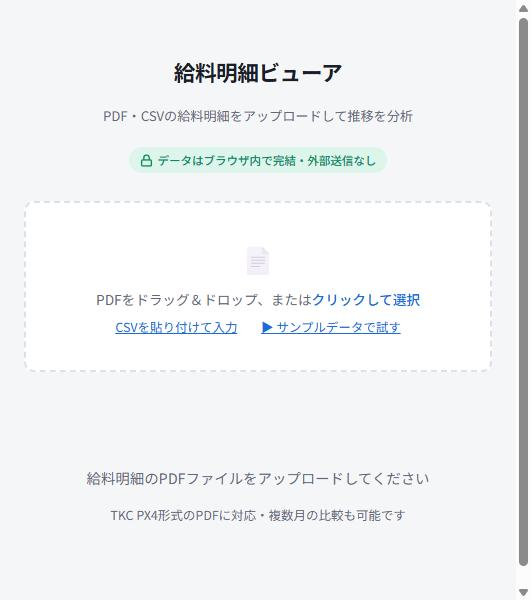
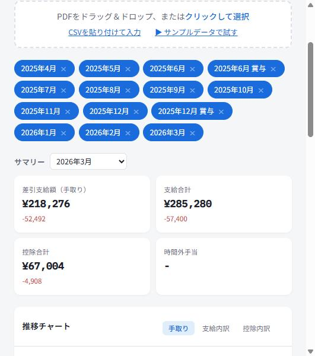
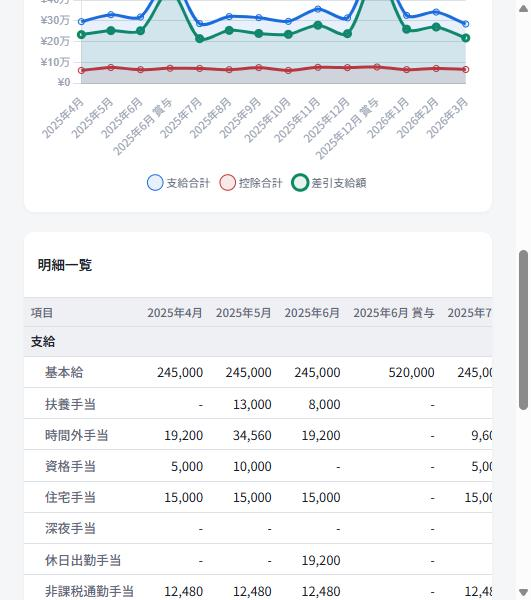

# 作品5:給料明細ビューア(Payslip Viewer)

給料明細を読み込み、手取りや支給・控除の推移を確認するツールです。毎月の明細を1枚ずつ見返すだけでは気づきにくい「少しずつの変化」を、グラフと一覧表でまとめて把握できます。

データはすべてブラウザの中だけで処理され、外部(サーバーなど)には送信されません。

## ▶ ツールを開く

[給料明細ビューアを使う](https://ruru105.github.io/work5-payslip-viewer/work5-payslip-viewer.html)

まずは「サンプルデータで試す」を押して、操作を体験できます。

---

## 目次

- [主な機能](#主な機能)
- [使い方](#使い方)
- [出力例](#出力例)
- [対応フォーマット](#対応フォーマット)
- [動作環境](#動作環境)
- [現在の制限](#現在の制限)

---

## 主な機能

- 給料明細のPDF(複数月まとめて読み込み可)またはCSVを取り込み、月ごとの支給・控除・手取りを自動集計
- 基本給・残業(時間外手当)・各種手当・社会保険料・所得税・住民税などを項目別に表示し、前月比の増減も確認
- 複数月分の推移を折れ線グラフで表示。「手取り」「支給内訳」「控除内訳」をタブで切り替え可能
- 月ごとの明細を一覧表で並べて比較

---

## 使い方

1. 上のリンクからツールを開く
2. 給料明細のPDFをドラッグ&ドロップ、またはクリックして選択(複数月まとめて選択可)。CSVを貼り付けての入力にも対応
3. 読み込んだ月が自動で一覧に追加される
4. サマリーカードで、選んだ月の手取り・支給合計・控除合計・残業代と、前月からの増減を確認
5. 推移チャートで複数月の変化をグラフで確認。タブで表示する項目を切り替えられる
6. 明細一覧で、月ごとの支給・控除の内訳を見比べる

---

## 出力例

### 1. PDF・CSVをアップロードして読み込み開始

### 2. サマリーカードで手取り・支給合計・控除合計・残業代と前月比を確認

### 3. 推移チャートと、月ごとの支給・控除の明細一覧

---

## 対応フォーマット

- TKC PX4形式のPDF給与明細
- CSVの貼り付け入力

---

## 動作環境

ブラウザだけで完結する1ファイルのツールです。インストールは不要で、最新のChrome・Edge・Safariなどで動作します。データはすべてブラウザ内で処理され、サーバーなど外部への送信は行いません。

---

## 現在の制限

- 対応しているPDF形式はTKC PX4形式です。異なる形式のPDFは正しく読み取れない場合があります
- 読み取り結果の最終確認は、ご自身の明細と見比べて行ってください
